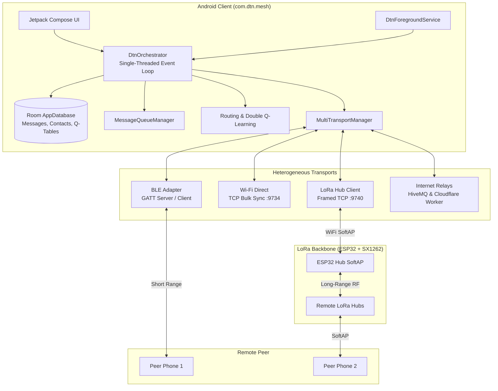

# DTN Mesh Relay Messaging System — Project Overview & Architecture

> **Executive Summary:**  
> An off-grid, peer-to-peer (P2P) **Delay-Tolerant Networking (DTN)** communication platform for Android. It enables reliable messaging in environments with zero cellular or internet coverage (disasters, remote zones, protests, tactical operations) using the **Store-Carry-Forward** model, heterogeneous radios (**BLE**, **Wi-Fi Direct**, **LoRa Hubs**), and hybrid reinforcement learning / probabilistic routing engines (**Double Q-Learning**, **MaxProp**, **PRoPHET**).

---

## 1. System Architecture at a Glance

The architecture separates concerns into a **central phone orchestrator**, **heterogeneous transports**, **custom LoRa hardware bridges**, and an **optional cloud fallback**.



---

## 2. Core Operational Concept: Store-Carry-Forward

Unlike traditional networks that require an active end-to-end circuit or internet connection:
1. **Store**: When user $A$ sends a message to user $B$ (who is miles away), $A$'s phone stores the message in a local encrypted SQLite (Room) queue.
2. **Carry**: User $A$ moves around, or encounters an intermediate user $C$ (**Data Mule**).
3. **Forward**:
   - $A$ opportunistically transfers the bundle to $C$ via short-range **BLE** or **Wi-Fi Direct**.
   - $C$ carries the bundle physically until $C$ encounters $B$ or a **LoRa Hub**.
   - Upon encounter, the bundle is delivered to $B$, and a signed end-to-end delivery receipt (`✓✓`) travels back along the reverse path.

---

## 3. The Heterogeneous Transport Layer

The app abstracts physical radios into a unified packet interface (`MultiTransportManager`):

| Transport | Range / Bandwidth | Role in System | Key Technical Detail |
|---|---|---|---|
| **BLE (Bluetooth Low Energy)** | Short (~10–30 m)<br/>Low (~2–10 KB/s) | **Primary Phone-to-Phone P2P link** | Split advertising (UUID in Main Packet, Node ID in Scan Response); custom GATT server with chunked MTU writes. |
| **Wi-Fi Direct** | Medium (~50–80 m)<br/>High (~5–20 MB/s) | **Bulk payload & queue sync** | Group Owner negotiation; raw TCP socket server on port `9734`; identity handshake (`HELLO`). |
| **Custom LoRa Hub** | Long (~2–10+ km)<br/>Ultra-low (~0.5–2 KB/s) | **Regional backbone bridge** | Phone joins hub's ESP32 SoftAP as Wi-Fi STA; framed TCP on port `9740`; independent of Meshtastic. |
| **Internet Relays (Optional)** | Global<br/>High | **Hybrid bridge when online** | Dual parallel relays: HiveMQ (MQTT) + Cloudflare Worker (WebSocket). Features `who_sees` multi-hop discovery to cross radio-to-internet boundaries. |

---

## 4. Hardware LoRa Hub & Firmware

Rather than requiring every phone to carry a LoRa radio, the system uses **shared standalone LoRa Hubs**:
* **Hardware:** Heltec WiFi LoRa 32 V3 (ESP32-S3 + Semtech SX1262 transceiver).
* **Firmware (`/firmware`):** Custom C++ written with PlatformIO and RadioLib (independent of Meshtastic).
* **Operation:**
  - Emits a Wi-Fi Access Point (`SSID: DTN-HUB-XXXX`).
  - Multiple phones connect concurrently over standard Wi-Fi.
  - Phones push pending messages to the hub over framed TCP (`HELLO` / `REGISTER` / `BUNDLE`).
  - Hub re-transmits bundles over **long-range sub-GHz LoRa RF** using deduplication, hop limits, and controlled flooding.

---

## 5. Intelligent Routing & Decision Engine

When a phone meets a peer, it must decide: **Should I forward this message now, or wait for a better carrier?**  
The user/developer can select between six strategies (`Developer Tools › Routing`):

```
                                  Routing Decision
                                         │
         ┌───────────────────────────────┴───────────────────────────────┐
         ▼                                                               ▼
 Classical Protocols                                              Reinforcement Learning
 • Epidemic (Controlled flooding, default)                        • Double Q-Learning Engine
 • PRoPHET / STABLE-PROPHET (Delivery predictability P(a,b))        9-feature state vector (RSSI, SNR, TTL,
 • MaxProp / DiMaxProp (Dijkstra over encounter costs)              buffer pressure, frequency, history).
                                                                    Actions: FORWARD vs. STORE_WAIT.
```

### Routing Strategies Explained:
1. **Epidemic (Default):** Floods copies to every encountered peer subject to hop limits and UUID deduplication. Maximizes delivery likelihood at the cost of bandwidth.
2. **PRoPHET (RFC 6693):**
   - Calculates delivery probability $P(a, b) \in [0, 1]$.
   - Increases with encounters ($P_{\text{enc}}$), decays over time ($\gamma^k$), and updates transitively through third parties ($P(a,c) = P(a,b) \cdot P(b,c) \cdot \beta$).
   - Features a **$\delta$-cap ($1 - \delta = 0.99$)** to prevent predictability saturation.
3. **MaxProp:** Formulates routing as a shortest-path graph problem where edge costs equal $(1 - \text{frequency})$. Runs Dijkstra to pick optimal next hops and assigns higher head-start priority to new bundles.
4. **Double Q-Learning:**
   - Evaluates a **9-dimensional normalized state vector** (RSSI, SNR, encounter frequency, contact duration, classical predictability, remaining TTL, buffer occupancy, success rate, duplicate count).
   - Solves for optimal action: `FORWARD` or `STORE_WAIT`.
   - Uses dual Q-tables ($Q^A$ and $Q^B$) to eliminate maximization bias and learns from delayed rewards ($+1.0$ on final delivery, $+0.3$ for intermediary hops, $-0.5$ on failure).

---

## 6. Security & Identity Model

* **End-to-End Encryption (E2EE):**
  - **Key Exchange:** X25519 elliptic curve Diffie-Hellman.
  - **Cipher:** AES-256-GCM with authenticated tags.
  - 1:1 Direct Messages and Private Groups are fully encrypted.
  - Public broadcast channel (`0xFFFFFFFF`) is transmitted in cleartext.
* **Identity:**
  - Each node generates an ed25519/X25519 identity keypair upon first launch.
  - Shareable via `dtnid:` URIs, QR codes, or web link landing pages (`https://<host>/c#...`).

---

## 7. End-to-End Message Lifecycle

```
[Author] ─► Types message in Compose UI
    │
    ▼
[Crypto] ─► Encrypts payload with recipient's X25519 public key (AES-GCM)
    │
    ▼
[Room DB] ─► Stored in 'messages' table with state = BUFFERED
    │
    ▼
[Discovery] ─► BleTransport / LoRa Hub detects an encounter
    │
    ▼
[Orchestrator] ─► Routing Engine ranks candidate bundles & decides FORWARD
    │
    ▼
[Transport] ─► Bundles chunked and transmitted across radio link
    │
    ▼
[Receiver] ─► Peer decrypts payload, shows notification, sends ACK receipt
    │
    ▼
[Status] ─► Origin node receives ACK ─► updates status from Sent (✓) to Delivered (✓✓)
```

---

## 8. Research & Developer Tooling

Designed for scientific delay-tolerant network evaluation:
* **Real-Time Instrumentation:** Tracks Q-values, state features, and packet hops in Room DB.
* **Data Exporter (`Settings › Developer Tools › Export Data`):**
  - Dumps raw CSV/JSON logs: `encounters.csv`, `contacts.csv`, `decisions.csv`, `messages.csv`, and `q_tables.json`.
  - Zero private message plaintext is ever logged or exported.
  - Ready for Python/Pandas/MATLAB offline simulation and training.

---

## 9. Project Directory Navigation

```
DTN-Relay-Messaging-App/
├── app/src/main/kotlin/com/dtn/mesh/
│   ├── crypto/       # X25519 + AES-256-GCM encryption & identity
│   ├── database/     # Room DB (messages, contacts, encounters, Q-tables)
│   ├── learning/     # Double Q-Learning engine & state evaluators
│   ├── queue/        # Store-carry-forward buffer & quota manager
│   ├── routing/      # PRoPHET, MaxProp, Epidemic strategy algorithms
│   ├── scheduler/    # WorkManager background maintenance (ForwardingWorker)
│   ├── service/      # DtnForegroundService, Orchestrator, & Transports (BLE/WiFi/LoRa/Relay)
│   └── ui/           # Jetpack Compose UI (Chats, Visualizer, Dev Tools)
├── firmware/         # Heltec WiFi LoRa 32 V3 PlatformIO C++ firmware
├── cloud/            # Cloudflare Worker WebSocket relay & Web landing page
└── docs/             # Technical specifications & feature checklists
```

